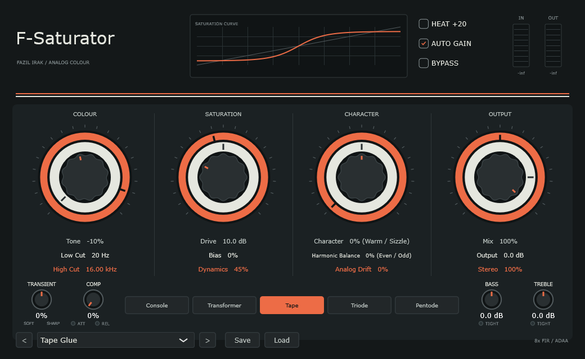

<!-- Fazıl Irak tarafından oluşturuldu / değiştirildi: 24.10.2026 -->
# F-Saturator 0.5.2 — FAZIL IRAK

[](https://github.com/fazilirak/Music/actions/workflows/fsaturator-release.yml)

[Windows x64](https://github.com/fazilirak/Music/releases/download/F-Saturator-v0.5.2/F-Saturator-0.5.2-Windows-x64.zip) · [macOS Universal](https://github.com/fazilirak/Music/releases/download/F-Saturator-v0.5.2/F-Saturator-0.5.2-macOS-Universal.tar.gz) · [Releases](https://github.com/fazilirak/Music/releases/tag/F-Saturator-v0.5.2) · [Source](https://github.com/fazilirak/Music/tree/main/F-Saturator)



Saturation and distortion with five character models, 16 factory presets and a compact concentric-control interface. Windows x64: VST3 and standalone. macOS Universal (Apple Silicon + Intel): VST3, AU and standalone, macOS 11.0 or later.

## New in 0.5.2

The product and bundle name is **F-Saturator**. The plugin editor is fixed at **1040 × 640**; manual window resizing is disabled. Plugin/parameter IDs, audio processing, preset formats and the existing user-preset directory are preserved.

## New in 0.5.1

A fourth concentric group between Saturation and Output adds **Character (Warm–Sizzle)** on the inner cap, **Harmonic Balance (Even–Odd)** on the middle ring and **Analog Drift** on the outer ring. All three default to neutral for old sessions and factory presets. [Turkish controls and maintenance guide](docs/CHARACTER_TR.md).

## Features

- **Console, Transformer, Tape, Triode and Pentode**: five independently designed character models.
- **Drive** 0–36 dB; **Heat** adds 20 dB. **Auto Gain** provides compensation calibrated against a reference tone. Use Output for the final level; Auto Gain is not programme loudness normalisation.
- **Tone**, pre-distortion **Low Cut** and post-distortion **High Cut** shape the frequency balance.
- **Bias** controls asymmetry; **Dynamics** adjusts dynamic loading and sag.
- **Mix**, **Output**, **Stereo** and latency-aligned **Bypass** control the result.
- Fixed 8× FIR oversampling, antiderivative antialiasing, parameter smoothing and DC removal.
- 16 factory presets, previous/next navigation and `.irakpreset` save/load.
- Embedded URW Gothic fonts provide the same lettering on both platforms.

Models are not measured hardware replicas. Tape does not simulate tape speed, hiss or wow/flutter.

## Downloads and installation

Use the [0.5.2 release](https://github.com/fazilirak/Music/releases/tag/F-Saturator-v0.5.2). Each platform has its own matching source ZIP, including complete pinned JUCE and font source collections, build scripts and notices. Platform manifests list SHA-256 values.

- Windows: extract the ZIP; copy the entire `VST3/F-Saturator.vst3` bundle into your shared VST3 directory. Open `Standalone/F-Saturator.exe` without a DAW.
- macOS: extract the TAR.GZ; copy the VST3 to `~/Library/Audio/Plug-Ins/VST3/` and the AU to `~/Library/Audio/Plug-Ins/Components/`. Open `Standalone/F-Saturator.app` without a DAW.
- Mac bundles are ad-hoc signed, not Developer ID signed or Apple notarised. Windows binaries are unsigned. Separate DAW and Intel Mac compatibility testing remains necessary.

## Build from source

C++17, CMake 3.24+, Ninja and Python 3.12+. Windows also needs Visual Studio desktop C++ tools; macOS needs Xcode Command Line Tools.

```sh
python scripts/bootstrap_juce.py
python scripts/bootstrap_fonts.py
```

The scripts verify fixed archive SHA-256 values. Complete release-source ZIPs already contain the dependencies and are checked in place. An ordinary repository checkout downloads them from their original repositories.

Windows, from an x64 Native Tools terminal:

```sh
cmake -S . -B build -G Ninja -DCMAKE_BUILD_TYPE=Release
cmake --build build --parallel 4
ctest --test-dir build --output-on-failure --timeout 300
python scripts/package_distribution.py --platform Windows
```

Alternatively run `scripts/build-windows.cmd`, then the package command. The helper discovers Visual Studio with vswhere; `FSATURATOR_VSROOT` overrides its location.

Mac Universal:

```sh
bash scripts/build-macos.sh
```

Tests cover sample-rate extremes, finite output, harmonic character, Auto Gain reference calibration, block-size invariance, preset recall, dry/bypass latency, model changes and editor interaction/rendering. They export 16 presets, six original audition WAVs, screenshots and a DSP report. Packaging additionally checks source hashes, binary versions, Mac architectures/signatures and archive contents.

## 0.5.1 changes

- Four concentric groups: Colour, Saturation, Character, Output; independent automation for all twelve rings.
- Warm–Sizzle adjusts nonlinear stage hardness; Even–Odd adjusts static-stage asymmetry and even-symmetric content.
- Subtle, stereo-linked Analog Drift varies drive and bias; no added hiss or pitch modulation.
- The original thirteen DAW parameter indices/IDs are preserved. Missing new fields in old sessions load at neutral; factory presets reset all three new controls.
- Added harmonic, drift/block-size, mono/stereo, silent-tail, state-migration and four-column UI regression checks.
- Neutral audio renders for all five models match the previous Windows reference WAVs byte for byte.
- [Türkçe kontrol rehberi](docs/CHARACTER_TR.md) · [English control guide](docs/CHARACTER_EN.md).

## 0.3.0 changes

- First macOS Universal release with AU, VST3 and standalone formats.
- Portable Windows build helper and verified GitHub Actions release flow.
- Updated Turkish code comments and maintenance documents from the local development tree.
- Complete matching dependency sources and third-party notices in distribution packages.
- Deterministic synthetic mouse-wheel events in UI regression tests; existing thresholds retained.
- Existing plug-in IDs, parameter IDs, `IRAK_STATE`, preset format and DSP behaviour preserved.

## Türkçe geliştirme belgeleri

- [Geliştirme ve kaynak haritası](GELISTIRME-TR.md)
- [Hata ayıklama rehberi](docs/HATA_AYIKLAMA_TR.md)
- [Mac derleme ve kurulum](docs/MACOS_TR.md)
- [Kaynak incelemesi](REVIEW-TR.md)
- [DSP araştırma notları](Research/DSP-RESEARCH.md)

F-Saturator bağımsız projedir; Shaper kaynaklarına veya arayüzüne derleme bağımlılığı yoktur. Ses motorunu ve kimlikleri koruyan bu sürüm, mevcut Türkçe bakım notlarını ve Mac dağıtım desteğini bir araya getirir. JUCE yolu gerektiğinde `-DIRAK_JUCE_PATH=...` ile değiştirilebilir; resmî dağıtım sabitlenmiş kaynakları kullanır.

## Licence

Copyright (c) 2026 Fazıl Irak. F-Saturator: **AGPLv3-or-later**, see [LICENSE](LICENSE). JUCE uses its AGPLv3 option; URW font licences and the font exception are preserved. See [THIRD-PARTY-NOTICES.txt](THIRD-PARTY-NOTICES.txt), [JUCE-LICENSE.md](JUCE-LICENSE.md) and `Resources/fonts`. Research references are documented rather than compiled third-party effect code. Publish the matching complete source with equivalent access alongside binaries.

[Website — Türkçe](https://fazilirak.com/f-saturator/) · [Website — English](https://fazilirak.com/f-saturator-english/)


## 0.5.1: Dynamics and tone strip
Transient / Comp + Fast ATT / Fast REL are left of the model bank; Bass / Treble + independent Tight switches are on the right. Neutral values preserve existing presets. All five saturation models support the strip. See docs/DESK_STRIP_TR.md.
