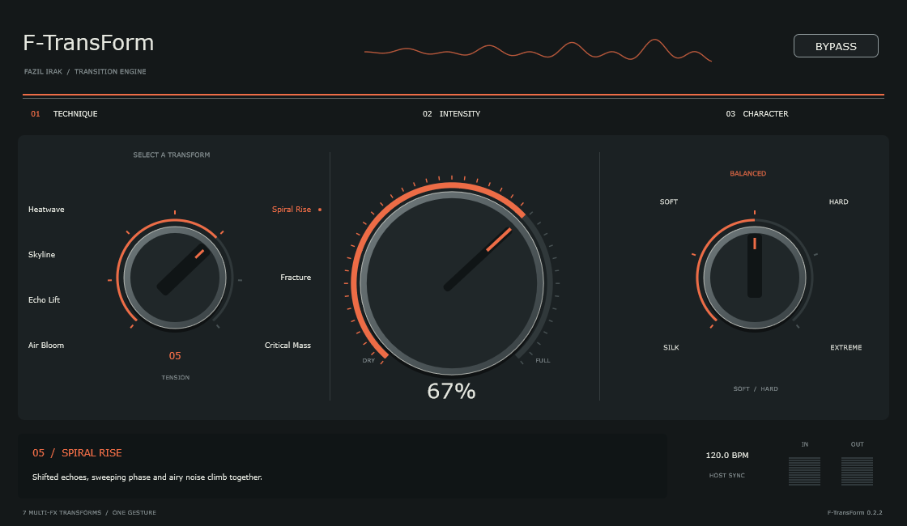
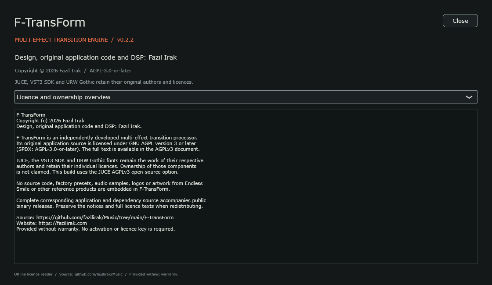

<!-- Developer: Fazıl Irak | Updated: 27.10.2026 -->
# F-TransForm 0.2.2

**One gesture. Build the tension.**

An independently developed multi-effect transition processor by **Fazıl Irak**. Seven transforms combine filtering, reverb, echo, drive and rising motion under one Intensity control. Three knobs, no preset bank.

| Downloads | Links |
| --- | --- |
| Windows x64 — VST3 + standalone | [Download ZIP](https://github.com/fazilirak/Music/releases/download/F-TransForm-v0.2.2/F-TransForm-0.2.2-Windows-x64.zip) |
| Linux x64 — VST3 | [Download TAR.GZ](https://github.com/fazilirak/Music/releases/download/F-TransForm-v0.2.2/F-TransForm-0.2.2-Linux-x64.tar.gz) |
| Complete corresponding source | [Source ZIP](https://github.com/fazilirak/Music/releases/download/F-TransForm-v0.2.2/F-TransForm-0.2.2-Source.zip) |
| Release notes and checksums | [F-TransForm 0.2.2](https://github.com/fazilirak/Music/releases/tag/F-TransForm-v0.2.2) |

## Features

- Seven multi-effect transforms: Air Bloom, Echo Lift, Skyline, Heatwave, Spiral Rise, Fracture and Critical Mass.
- Continuous Intensity, stepped transform and stepped Silk-to-Extreme Character.
- Tempo echo, rising filters, hall with an Intensity-controlled output high-pass, phase and frequency-shifted layers.
- Exact dry output at zero intensity, smooth parameter changes and session recall.
- Offline About, ownership information and seven full licence documents opened from the logo.

## Install and build

Copy the entire VST3 bundle into your DAW's VST3 directory and rescan. Standalone: Standalone/F-TransForm.exe. Windows binaries are unsigned. macOS Universal VST3/AU/Standalone is available separately; see the Mac package below.

From Git: python scripts/bootstrap_juce.py, then scripts/build-windows.cmd with Visual Studio C++ tools. Complete source archives contain pinned JUCE and the URW font source collection. See [development guide](docs/GELISTIRME_TR.md).

## Licence and ownership

Original application code, DSP, interface and generated test audio: **© 2026 Fazıl Irak**, AGPL-3.0-or-later. JUCE, VST3 SDK and URW Gothic retain their original licences. No reference-product source or assets are included. See [authors](AUTHORS.md), [full licence](LICENSE), [overview](licenses/Overview.txt) and [third-party notices](THIRD-PARTY-NOTICES.txt).

## Türkçe kullanım ve bakım

<!-- Geliştirici: Fazıl Irak | Oluşturma / son düzenleme: 27.10.2026 -->
# F-TransForm 0.2.2 — Multi-FX Transforms

Fazıl Irak tarafından geliştirilen üç kontrollü transition efekti. 0.2 sürümü, ayrı ayrı uygulanan 17 tekniği **7 çoklu efekt makrosuyla** değiştirir. Intensity; filtreyi, reverb'ü, echo'yu, hareketi ve gerektiğinde noise/riser katmanını farklı eğrilerle birlikte yönetir.

Endless Smile'ın tek hareketle buildup yaklaşımı referans alınmıştır; kapalı kaynak algoritmalarının veya fabrika ayarlarının birebir ölçülmüş kopyası değildir. Referans eklentiyle ses eşleştirmesi yapılmamıştır.

## 0.2.1 değişikliği

Echo Lift delay katmanı yaklaşık 8.4 dB güçlendirildi, feedback artırıldı ve hall seviyesi azaltıldı. Reverb çıkışına da Intensity ile yükselen HP eklendi; önceden birikmiş kuyruklar da incelir.

Character kademelerinin yedi modun tamamında sesi değiştirdiği 28 bitişik-kademe karşılaştırmasıyla ölçülür; sonuç dist/CHARACTER-CHECK-0.2.1.csv içindedir. Character motoru bu sürümde değiştirilmedi. dist/Character-0.2.1 içindeki Echo Lift ve Spiral Rise örnekleri aynı kaynak ve sabit %60 Intensity ile Silk/Extreme karşılaştırması sunar.

## Kontroller

- **Sol / Technique:** Air Bloom, Echo Lift, Skyline, Heatwave, Spiral Rise, Fracture, Critical Mass. Yedi sabit konum. Sürükle, tekerleği kullan veya ada tıkla.
- **Orta / Intensity:** Kesintisiz 0–100%. Bu parametreyi buildup boyunca otomasyona al. Katmanlar farklı noktalarda devreye girer. Sıfır, kuru sestir; drop'ta sıfıra dön.
- **Sağ / Character:** Silk, Soft, Balanced, Hard, Extreme. Makro eğrisini, filtre son frekansını, drive ve noise şiddetini değiştirir.
- **Bypass:** Kuru sese yumuşak geçiş.

Preset menüsü, preset bankası ve preset dosyası yoktur. Yedi mod, işlem türüdür; DAW program/preset listesi değildir. DAW projesi üç kontrolü ve bypass'ı kaydeder.

Onaylı koyu panel, renkler, font, üç knob yerleşimi, çizgisiz teknik adları ve harflerin dikey merkezine hizalı seçim noktaları korunmuştur.

## Makrolar

| Makro | Birlikte çalışan temel katmanlar |
|---|---|
| Air Bloom | Nazik HP/low cut + geniş hall. |
| Echo Lift | Low cut + noktalı sekizlik echo + hall. |
| Skyline | Yükselen HP + echo + hall + phase hareketi. |
| Heatwave | Daha derin HP + sıcak drive + phase + echo/hall. |
| Spiral Rise | HP + yükselen phase + frekans kaydırılmış echo + noise + tonal katman. |
| Fracture | Keskin HP + güçlü drive + kaydırılmış echo + phase/noise. |
| Critical Mass | Bütün katmanlar + son %9 bölgede çözülme; %100'de sessizliğe ulaşır. |

Karakter Balanced iken son HP hedefleri sırayla yaklaşık 220, 480, 4200, 6800, 8800, 11200 ve 14500 Hz'dir. Bu sayılar bizim motorumuzun hedefleridir. Örnekleme hızı üst sınırı korur.

## Hazır çıktılar

- `dist/Standalone/F-TransForm.exe`: bağımsız Windows uygulaması.
- `dist/VST3/F-TransForm.vst3`: DAW'a kurulacak bütün VST3 klasörü.
- `dist/F-TransForm-0.2.2-Windows-x64-VST3.zip`: güncel VST3 paketi.
- `dist/Auditions-0.2/`: aynı özgün stereo techno loop'un kuru hali ve yedi makro karşılaştırması.
- `docs/TEKNIKLER_TR.md`: ayrıntılı makro haritası.
- `docs/GELISTIRME_TR.md`: kaynak haritası, testler ve bakım.
- `docs/REFERANS_INCELEMESI_TR.md`: kaynakların neyi doğruladığı ve incelemenin sınırları.

Dinleme dosyalarında bir saniye kuru giriş, ardından yaklaşık sekiz bar yükselen Intensity ve son iki saniyede sıfıra dönüş vardır. Hepsi aynı kaynak ses, tempo ve Balanced karakterle üretilir.

## Derleme

Visual Studio C++ araçları, CMake 3.24+, Ninja, JUCE 8.0.7. Ortak JUCE `../_Dependencies/JUCE` içinde; farklı yol için `-DFT_JUCE_PATH=...`.

1. `scripts/build-windows.cmd`: Release derlemesi ve CTest.
2. PowerShell 7 ile `./scripts/package-windows.ps1`: dosyaları dist içine kopyalar, SHA-256 manifesti üretir.

Windows VST3/Standalone ve macOS Universal VST3/AU/Standalone yayımlanır. Yerel Mac CI CTest kontrollerini geçmiştir; fiziksel Intel Mac ve üçüncü taraf DAW testleri ayrıdır. Windows dosyaları imzasızdır.

## Ses ve uyumluluk

Echo host BPM'ini izler; tempo yoksa 120 BPM. Phase/riser hareket hızı tempoya bağlıdır, serbest sürekli fazla ilerler. Kuru yola ek gecikme uygulanmaz; frekans kaydırılan paralel katmanın kendi kısa FIR gecikmesi vardır.

Giriş enerjisi sönünce noise/riser beslemesi kapanır; reverb/echo sonlanır. Intensity sıfıra dönünce kuyruk da karışımdan çıkar. Efekt yolunda yüksek tepe koruması bulunur; kuru giriş aynen korunur. Bu, mastering limiter'i veya loudness normalizasyonu değildir. Drive oversampling kullanmaz.

0.1 ses motoru kaldırılmıştır. Eski DAW durumundaki teknik indeksleri yakın bir yeni makroya taşınır; eski ses veya kayıtlı otomasyonun aynı sonucu vermesi beklenmez. Eski VST3 ZIP'i ve `dist/F-TransForm-0.1.0-Source-backup.zip` korunur. Eski `dist/Auditions/` dizini yalnız 0.1 arşividir; yeni karşılaştırmalar `Auditions-0.2` içindedir.

AGPL-3.0-or-later. JUCE ve URW Gothic özgün lisansları korunur; bkz. THIRD-PARTY-NOTICES.txt.

## macOS Universal

[Download F-TransForm 0.2.2 — Apple Silicon + Intel](https://github.com/fazilirak/Music/releases/download/F-TransForm-v0.2.2/F-TransForm-0.2.2-macOS-Universal.tar.gz). macOS 11.0+; VST3, Audio Unit and standalone. Native macOS CTest passed; both Mach-O architectures and ad-hoc signatures were verified. Physical Intel Mac and third-party DAW testing remain separate.

Copy the complete VST3 bundle to `~/Library/Audio/Plug-Ins/VST3/` or the AU component to `~/Library/Audio/Plug-Ins/Components/`, then rescan your host. Mac bundles are ad-hoc signed, not Developer ID signed or Apple notarised. The matching `F-TransForm-0.2.2-macOS-Source.zip` includes complete pinned dependency sources and `BUILD-MACOS.txt`; hashes and build provenance are in `macOS-RELEASE-MANIFEST.json`. [Repository build guide](../docs/ORIGINALS_MACOS_TR.md).
