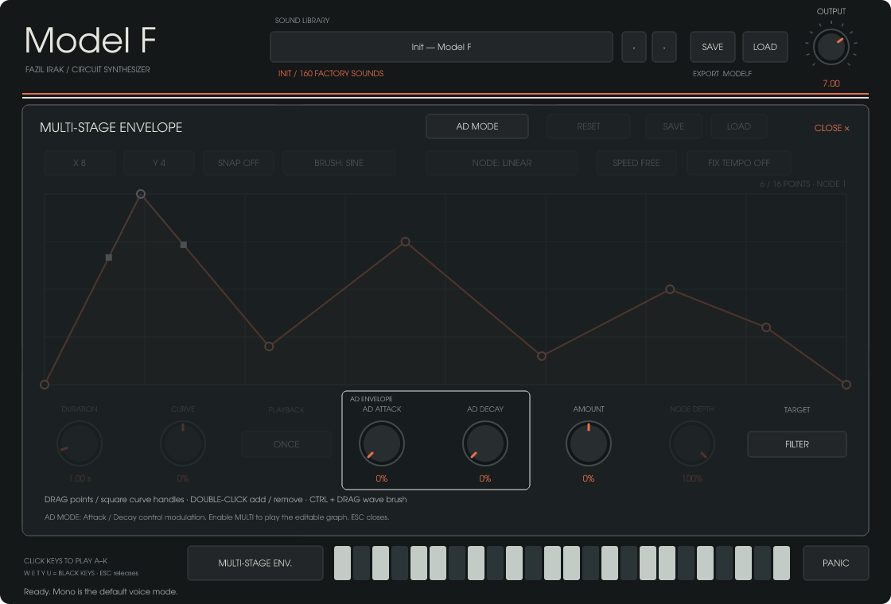

<!-- Türkçe bakım: Fazıl Irak | 25.10.2026 -->
# Model F

Az kontrol, güçlü analog karakter. Windows x64 ve macOS Universal için VST3, CLAP ve bağımsız synthesizer.


## Başlangıç

`dist/Model-F-Windows-0.2.2/Model F.exe` bağımsız çalışır. Ekrandaki tuşlara basarak çalabilirsiniz. Tuş alanına tıkladıktan sonra bilgisayar klavyesindeki A W S E D F T G Y H U J K tuşları da çalışır. PANIC, basılı notaları, uzun contour sönümlerini, multi-stage modülasyonu ve arpeggiator HOLD durumundaki sesi kısa bir fade ile susturur. İstek fare bırakma/klavye güncellemelerinden ayrı tutulur; çok kısa tıklama da kaybolmaz. Yeni notalar yeniden çalar; DAW yeni MIDI notaları göndermeye devam ederse yeni sesler üretebilir.

VST3 için `Model F.vst3` klasörünü DAW'ın taradığı VST3 klasörüne; CLAP için `Model F.clap` dosyasını CLAP klasörüne kopyalayın. DAW'da eklentileri yeniden taratın. VST3 ve CLAP kimlikleri Model F'e özeldir.

Model F başlığına tıklayarak FAZIL IRAK şirket adını ve sürüm bilgisini gösteren About penceresini açabilirsiniz. ESC, Enter veya CLOSE ile kapanır.

## 0.2.2 Windows metin girişi

Windows'ta ana **SAVE**, isim ve kategori içeren tek standart Windows penceresi açar. Save kullanıcı ses kütüphanesine kaydeder; Cancel değiştirmez. Arkada ikinci bir kaydetme paneli açılmaz. Sound Library içindeki **SEARCH** alanına tıklayın; açılan Windows penceresine sorguyu yazıp Search seçin. Clear sorguyu temizler, Cancel önceki sorguyu korur. Arama seçili kategoride preset adını ve açıklamasını büyük/küçük harften bağımsız eşleştirir; arama yapmak ses yüklemez. Türkçe karakterler ve standart metin düzenleme Windows EDIT kontrolüyle işlenir. Kaydetme ve arama görünümüne özel skin uygulanmamıştır. Mac sürümü mevcut panel tabanlı isim/arama girişini korur.

## İndirme

- [Windows x64](https://github.com/fazilirak/Music/releases/download/Model-F-v0.2.2/Model-F-0.2.2-Windows-x64.zip)
- [macOS Universal](https://github.com/fazilirak/Music/releases/download/Model-F-v0.2.2/Model-F-0.2.2-macOS-Universal.tar.gz)
- [Sürüm ve eşleşen kaynak paketleri](https://github.com/fazilirak/Music/releases/tag/Model-F-v0.2.2)

## 0.2.2 Multi tempo ve Reset

Multi panelinde **SPEED**: Free / x1 / x2 / x4 / x8 / x16 / x32. Free, DURATION saniyesini kullanır ve eski presetlerin zamanlamasını korur. Tempo seçiliyken x1 tam zarfı 8 dörtlük vuruşta, x2 4, x4 2, x8 1, x16 yarım ve x32 çeyrek vuruşta oynatır. Bunlar çizim ızgarasından bağımsızdır. **FIX TEMPO ON** sabit 120 BPM kullanır; OFF, DAW temposunu veya tempo bilgisi yoksa ana TEMPO düğmesini kullanır. Tempo modunda DURATION kilitlenir ve CLOCK gösterir. Once / Loop / Hold seçimi korunur. Tempo değişikliği zarfın fazını sıfırlamaz; nota tetiklemesi yine başlangıçtan oynatır.

**RESET**, grafiği sıfır seviyesinde düz çizgiye temizler; Amount, Target, tempo, çalma modu ve AD ayarlarını değiştirmez. Volume hedefi ve %100 Amount ile sıfır çizgisi sesi susturabilir; gerektiğinde Amount'u sıfırlayın veya grafiği yükseltin. Reset ve tempo düğmeleri AD modunda pasiftir. Yeni tempo alanları ses/şekil dosyaları ve DAW oturumunda saklanır; eski 0.2.1 preset ve şekilleri Free modunda açılır.

## 0.2.1 arayüz düzeltmesi

OSC seçicileri ve alt knob değerleri kendi çerçevelerinin içine alındı. Filter/Audio Env kutuları dış panelin içinde alt boşluk bırakır. Ses motoru ve 160 seslik banka 0.2.0 ile aynıdır.

## 0.2.0 yenilikleri

İki ayrı OSC alanında dalga biçimi, oktav ve seviye ayarlanır. OSC 1 TUNE ±12 yarım ses, OSC 2 DETUNE ince frekans farkını belirler. **SYNC**, OSC 1'i master, OSC 2'yi slave yapar. **FM**, OSC 2'nin seçili dalgasıyla OSC 1'in frekansını modüle eder; FM DEPTH derinliğidir. OSC 2 LEVEL sıfırken FM hâlâ çalışır. SuperSaw tek yedili bank olduğu için OSC 2/Sync/FM kontrolleri bu modda pasiftir.

AD modu ile Multi kontrolleri birbirinden ayrıldı. AD+Amount etkinse ana buton logo beyazı; Multi etkinse turuncudur. AD panelinde yalnız Attack/Decay aktiftir; Multi'de bu ikisi pasif, grafik/ızgara/eğri/oynatma aktiftir. Amount ve Target ortaktır.

**160 yeni fabrika presetinin 80'i AD, 80'i Multi kullanır.** Bass, Lead, Key, Pad, FX ve Arp kategorilerinde FM, Sync, Ring, SuperSaw, noise ve farklı çift osilatör düzenleri vardır. Multi sesler perde cümleleri, vurgulu amplitude kapıları ve filtre desenleri çalar. Uzun hareketleri duymak için notayı basılı tutun. Pad cümleleri 5.2–8.5 saniyedir. Arp kategorisinin ilk yarısı klasik arpeggiator, ikinci yarısı tekrar tetiklenmeden ilerleyen Multi sekanslardır. Fabrika bankası Free zamanlamasını korur. 0.2.2 ile SPEED seçilerek DAW temposuna veya sabit 120 BPM’e bağlanabilir. Fabrika bankası yenilenir; kullanıcı preset dosyaları korunur.

Eski preset/oturumlarda OSC 2 dalga/oktav ve Audio ADS başlangıçta eski ortak ayarları izler. İlk düzenlemede bu alanlar ayrılır; yeni kayıtlar çözümlenmiş değerleri saklar. Eski host parametre kimlikleri korunur.

Bilgisayar klavyesi için ekran tuşlarına veya **CLICK KEYS TO PLAY A–K** alanına tıklayın. Düğmeleri ayarlarken klavye odağı kalır. ESC basılı notaları bırakır. Türkçe klavye düzeninde fiziksel tuş konumları kullanılır.

## Ses motoru

- **MONO (varsayılan):** iki devre osilatörü, tek nota; en düşük basılı nota önceliklidir.
- **POLY:** dört nota, her notada iki devre osilatörü.
- **SUPERSAW:** sabit **7 saw osilatörü**, bir merkez ve altı yan osilatör. Ses sayısı seçilmez; DETUNE dağılımı ayarlar. Yedi osilatör ortak ladder filtre ve VCA'ya girer. Dalga bu modda saw olarak sabittir. Bu mod 8 nota polifonisine sahiptir (en fazla 56 saw osilatörü). Her notanın kendi ladder filtresi ve VCA/contour devresi vardır. Boş sesler işlenmez; sönmekte olan notalar polifoniye dahildir. Sınır dolduğunda önce bırakılmış en eski nota, yoksa basılı en eski nota yeniden kullanılır.
- **OCTAVE / FIFTH:** ikinci osilatör bir oktav / yedi yarım ses yukarıdadır; monofonik çalınır.
- **RING / RING POLY:** filtre öncesinde iki osilatörün dengeli çarpımı; mono / dört nota.

Osilatörler, nonlinear ladder filtre, noise ve contour devre modelleridir. **FILTER ENV** ve **AUDIO ENV** ayrı Attack/Decay/Sustain kontrollerine sahiptir. CONTOUR DECAY açıkken tuş bırakıldıktan sonraki sönüm DECAY süresini kullanır. LFO, klavyeden ayrılmış üçüncü devre osilatörüdür. MOD DEPTH ve OSC MOD / FILTER MOD yönlendirmeleriyle kullanılır; MIDI mod wheel ek derinlik sağlar. Pitch bend ±2 yarım sestir.

SuperSaw'ın asimetrik frekans dağılımı ve detune eğrisi JP-8000 ölçümlerinden türetilmiştir. Kaynak: [Adam Szabo, How to Emulate the Super Saw, 2010](https://www.adamszabo.com/internet/adam_szabo_how_to_emulate_the_super_saw.pdf), s. 9–15. Yedi osilatörde de Model F devre çekirdeği korunur. Merkez/yan seviye karışımı sabit .75'tir; temel frekansı takip eden high-pass kullanılır.

SuperSaw, işlemciye pay bırakmak için 8 nota ile sınırlandırılmıştır. Devre modeli nedeniyle sample rate, preset ve bilgisayarın yükü performansı etkiler. Ölçümler ve test kapsamı: [performans notları](docs/performance.md).

## Kontroller

Düğmeleri yukarı/aşağı sürükleyin; SHIFT hassas ayar yapar. Mouse tekerleği de çalışır. CTRL-tıklama veya ALT-tıklama başlangıç değerine döndürür. Seçiciler sol tıklamayla ileri, sağ tıklamayla geri gider. Envelope noktaları ve eğrileri dahil 174 parametre DAW otomasyonuna açıktır.

## Multi-Stage Envelope

PLAY A–K yazısı ile klavye arasındaki **MULTI-STAGE ENV.** butonu, preset tarayıcısıyla aynı alanda büyük düzenleyiciyi açar. Klavye ve MIDI çalışmaya devam eder. ESC, CLOSE veya aynı butonla kapanır. Buton PANIC ile aynı yüksekliğe sahiptir; Multi devredeyken turuncudur ve düzenleyici kapansa da turuncu kalır. Üstteki turuncu-beyaz çift çizgi preset başlığıyla synth alanını ayırır.

- **MULTI ON / AD MODE:** Multi açıkken grafik, kapalıyken AD ATTACK / AD DECAY ek modülasyonu üretir. Ana contour bölümü çalışmaya devam eder.
- Altı noktayla başlar; en fazla 16 iç nokta eklenebilir. Boş yere çift tıklayın; noktaya çift tıklayarak veya Delete ile silin. Noktalar sürüklenir, ok tuşlarıyla taşınır; Shift hassas ayardır.
- Bir noktayı seçince ayrı sol/sağ eğri tutamakları görünür. Kareleri sürükleyin; çift tıklama eğriyi sıfırlar. Başlangıç/bitiş seviyeleri birbirine bağlıdır.
- **X / Y / SNAP:** X 2–16 hücre, Y 2–64 bölme; snap eklenen ve taşınan noktaları ızgaraya hizalar.
- **CTRL + sol sürükleme:** seçili BRUSH dalgasını hücrelere çizer. Yükseklik derinliği belirler. Sine, Triangle, Saw Up/Down, Square, Pulse, Steps, Random vardır. NODE ve NODE DEPTH seçili noktadan başlayan parçanın dalgasını/derinliğini düzenler.
- **DURATION:** Free modunda 0.05–10 saniye; SPEED seçiliyse tempo belirler. **CURVE:** bütün segmentlere ortak eğrilik. **ONCE:** bir kez; **LOOP:** tuş basılıyken döngü; **HOLD:** son iç noktada bekleme. Loop/Hold tuş bırakıldığında 20 ms'de sıfıra iner. Once grafiğin sonuna kadar devam eder.
- **AMOUNT / TARGET:** yalnızca **Filter**, **Oscillator Pitch**, **Volume (Output)**. Filter cutoff'u, Pitch iki osilatörün perdesini birlikte modüle eder; SuperSaw'da yedi osilatör birlikte izler. Filter/Pitch Amount iki yönlüdür. Volume'da sıfır Amount normal seviyeyi korur; +%100 envelope şeklini, -%100 tersini çıkış seviyesine uygular. Volume modülasyonu 0–1 kazanç aralığındadır; ek seviye yükseltmez. Output düğmesinin değeri değişmez.
- Envelope içindeki **SAVE / LOAD**, yalnızca şekli ve playback/ızgara ayarlarını `.modelfenv` dosyasında saklar. Synth, Amount, Target ve AD ayarları korunur. Ana preset SAVE bütün envelope ayarlarını sesle birlikte kaydeder; DAW oturumu da bunları saklar.

Machine'daki breakpoint düzenleyicinin davranışları Model F'nin devre motoruna uyarlanmıştır. Eski 27 kontrollü presetler ve eski DAW oturumları yeni modülasyon kapalı olarak açılır. JUCE bağımlılığı yoktur; arayüz Rust, baseview/softbuffer ve SVG çizimi kullanır.

0.1.3 ve önceki altı hedefli sesler/oturumlar yüklenirken Filter korunur; iki ayrı pitch hedefi ortak Pitch'e, kaldırılan FM/Pulse Width hedefleri Volume'a dönüşür. Eski Off hedefi, Filter / Amount 0 olarak sessiz modülasyonu korur. Yeni ses dosyaları format 2 olarak kaydedilir. Envelope şekil dosyaları hedef içermediğinden uyumludur.



## Arpeggiator

ARP ile açılır. UP, DOWN, UP/DOWN ve RANDOM; 1–3 oktav; 1/4, 1/8, 1/8T, 1/16, 1/16T, 1/32; GATE ve HOLD bulunur. HOST açıkken DAW temposu, kapalıyken TEMPO kullanılır. DAW tempo bilgisi sağlamıyorsa TEMPO kullanılır. Kalıp ilk notada başlar. DAW durduğunda veya zaman çizgisi geriye atladığında basılı arp notaları temizlenir. HOLD açıkken tüm tuşları bıraktıktan sonra çalınan yeni akor öncekinin yerini alır. Devre contour'unun yeniden tetiklenebilmesi için gate arası en az yaklaşık 14 ms tutulur.

## Presetler

**160 yeni hazır ses:** 80 AD ve 80 Multi. Bass 26, Lead 26, Key 26, Pad 28, FX 26, Arp 28. Aramaya `Multi`, `AD`, `FM` veya `sync` yazarak ilgili sesleri bulabilirsiniz. Preset adına tıklayın; kategori veya metin aramasıyla seçin. Oklarla önceki/sonraki sese geçilir. Değiştirilen sesin yanında bir nokta görünür.

- **SAVE:** ad ve kategori seçerek kullanıcı kütüphanesine kaydeder. Aynı kullanıcı adı varsa yeni ad ister.
- **LOAD:** `.modelf` dosyası açar.
- **EXPORT .MODELF:** mevcut sesi seçtiğiniz dosyaya kaydeder.
- Kullanıcı sesleri: `%APPDATA%/Model F/Presets`. `MODEL_F_PRESETS` ortam değişkeniyle farklı klasör seçilebilir.
- DAW oturumu bütün parametreleri ve preset adını saklar. Kullanıcı presetleri fabrikadan ayrı dosyalardır.

Yeni bankadan seçilmiş örnekler ve birleştirilmiş demo `docs/audio-020` klasöründedir. Demo WAV'ları dinleme için -3 dBFS tepe seviyesine getirilmiştir. Ham preset ölçümleri `validation.json` içindedir.

## Kaynaktan derleme

Rust 1.97.1 ve Windows için Visual Studio C++ Build Tools / Windows SDK gerekir.

```powershell
.\build.ps1 -Test -PackageSource
```

Bu komut release sürümlerini derler, testleri çalıştırır ve `dist` altında Windows paketini ve isteğe bağlı kaynak ZIP'ini oluşturur. GitHub Actions Windows x64 ve macOS Universal (Apple Silicon + Intel) paketlerini üretir. Preset/envelope dosya diyalogları Windows ve macOS üzerinde açıktır. Canlı DAW/donanım testleri ayrıca gereklidir.

```powershell
cargo run -p model-f --example preview --release -- docs
cargo run -p model-f --example render-bank --release -- docs/audio-020
```

## Overload

Overload (0–10), sesi miksere ve filtreye kısa, sınırlı bir geri besleme yoluyla döndürür. Yumuşak asimetrik doyum ve geri dönüşte üst frekans yumuşatması kullanır. Emphasis yükseldikçe geri besleme kazancı azalır; her yeni vuruşta yalnızca geri besleme yaklaşık 24 ms içinde kademeli olarak oturur. Osilatör çekirdeği ve amplifikatör envelope ayarları korunur. Turuncu LED doyum katının gerçek giriş yükünü izler. Sıfırda önceki kuru ses birebir korunur.

0.1.9’da Overload, sınırlı geri beslemeye ek olarak filtre önündeki mikseri belirgin biçimde doyurur. Orta ve yüksek ayarlarda harmonik içerik ve tepe sıkıştırması artar; etki yalnızca çıkış kazancına dayanmaz. İlk vuruş yumuşatması ve rezonansa göre geri besleme sınırı korunur. Karşılaştırmalı WAV dosyaları `docs/overload-audio` içindedir; dinleme seviyeleri RMS olarak eşitlenmiştir.

## Lisans

GPL-3.0-or-later. Modifiye devre DSP ve gerçek zamanlı zamanlama kodunun telif hakkı © 2026 Idle Foundry Ltd. olarak korunur. Ayrıntılar `LICENSE` ve `THIRD-PARTY-NOTICES.txt` içindedir. Bu proje bağımsızdır; ürün adları teknik referans amacıyla kullanılmıştır.


## Yeni geliştirme konumu

`Codex/Music/Model-F` içinden çalışın. [Türkçe geliştirici ve hata müdahale rehberi](docs/GELISTIRICI_REHBERI_TR.md). Eski mutlak build yollarını yeniden kullanmayın.
