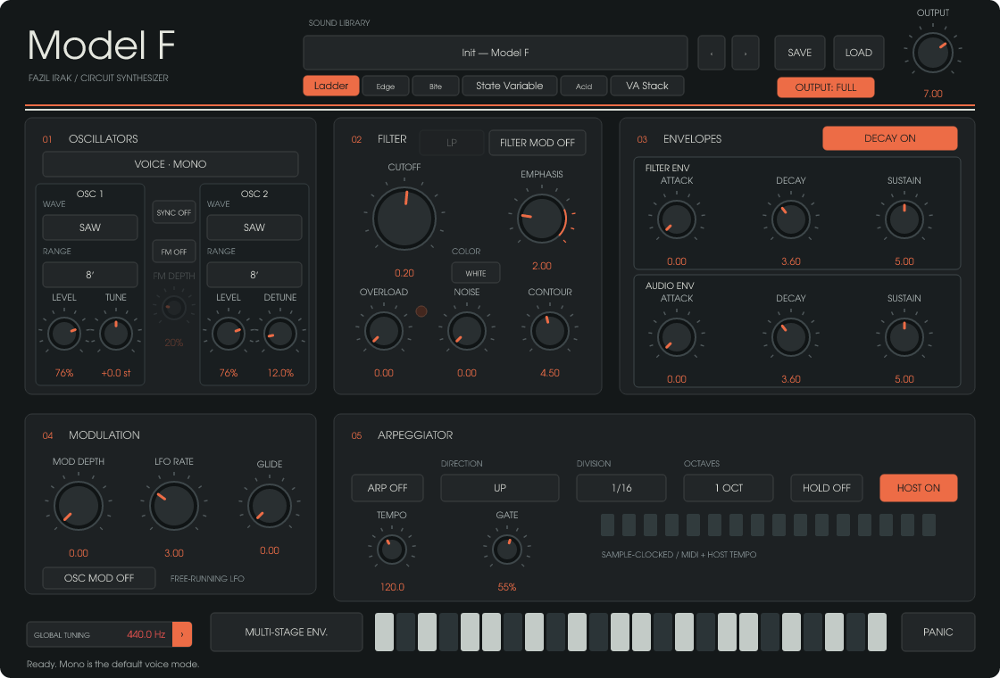
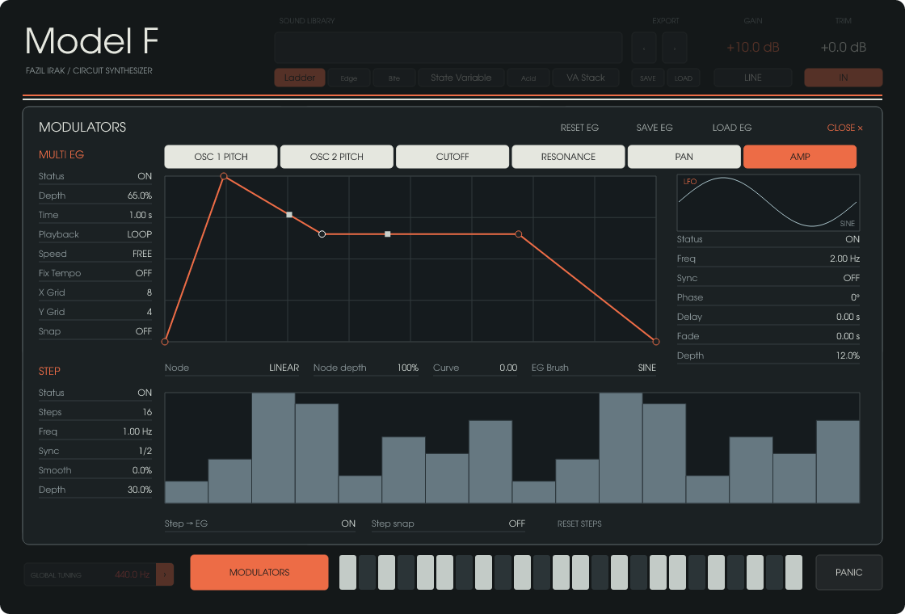

# Model F 0.3.0

**Draw the movement. Shape the character.** A free, open-source synthesizer developed and maintained by **Fazıl Irak**, with circuit-modelled sound, dual oscillators, six character choices and independent modulation for evolving basses, leads and rhythmic textures.

## Downloads

[Current release: Windows x64, macOS Universal and Linux x64](https://github.com/fazilirak/Music/releases/tag/Model-F-v0.3.0) · [Türkçe product page](https://fazilirak.com/model-f/) · [English product page](https://fazilirak.com/model-f-english/)

Packages are attached only after native platform builds and automated checks pass. Windows/macOS include VST3, CLAP and standalone; Linux package contents are described in the release. Complete matching source and licence notices accompany the binaries. macOS 11+: arm64 + Intel, ad-hoc signed; no Apple notarisation or AU.

## Independent movement for six destinations

OSC 1 Pitch, OSC 2 Pitch, Cutoff, Resonance, Pan and Amp each have their own **Multi EG, LFO and Step Sequencer**: 18 independent modulation sources. Switching pages keeps other enabled sources running. Each source has its own Status and depth; the two pitch pages control their own oscillators.

- **Multi EG:** start with a simple envelope drawing, then add up to 16 interior points. Edit segment curves, per-node wave shapes/depth and paint with the eight-wave EG Brush. Once/Loop/Hold, free or tempo-based timing, fixed tempo, X/Y grids, snap and shape save/load are included.
- **LFO:** eight shapes, frequency or tempo sync, phase, delay, fade and one-shot operation.
- **Step:** 2–128 steps, tempo sync, smoothing, depth, one-shot and note-advance modes. Draw levels, apply level snap or use Step → EG to retrigger that destination's envelope.
- The panel uses compact label–value rows. Selected target: orange; another target with an enabled source: ivory; all sources OFF: grey. The main MODULATORS button is orange only when a visible source is enabled.

Pitch/filter/resonance/pan contributions add within their destination. Amp contributions multiply with the existing amplitude path. Main-page envelopes and modulation controls remain part of the sound engine; the new panel provides additional movement. See the [routing and compatibility guide](docs/MODULATORS-030-TR.md).

## Colour and level: the new preamp

The former Output knob and Full/Legacy switch are replaced by **GAIN, TRIM, MIC/LINE and IN**.

- Drag or wheel the numeric **GAIN** value (0–36 dB) to increase drive and saturation. Its value is orange.
- **TRIM** (−60 to +12 dB) sets the final output level independently of the drive setting. Its value is ivory.
- **MIC** reaches saturation earlier; **LINE** provides cleaner headroom.
- **IN** bypasses the colour stage when disabled; Trim remains active.

This is an original Model F saturation design with asymmetric soft saturation, DC blocking and first-order antiderivative antialiasing. It is not a model of the pictured reference preamp and is not a limiter.

## The Model F sound engine

Two oscillators with individual waveform/range/level controls, Sync and FM; mono/poly, ring and seven-oscillator SuperSaw options; separate Filter and Audio envelopes, arpeggiator, noise, Overload and **160 factory presets**.

Choose **Ladder, Edge, Bite, State Variable, Acid or VA Stack**. Character choices are original algorithms, not claims of exact historical instrument emulation. SuperSaw/VA Stack use a single seven-oscillator bank; OSC 2 Pitch, Sync and FM do not apply to that bank.

Global Tuning is independent of presets and stored with the DAW session. Its quick selector offers 432, 440, 442, 444 and 528 Hz.

## Compatibility and validation

Existing plugin identities and host parameter IDs/order are retained. Older presets/sessions initially use their legacy sound path. On the first new-panel edit, a visibly enabled legacy Multi EG is transferred; a hidden legacy AD does **not** turn on another destination. Entering the new system disables that hidden legacy AD path. Shared legacy pitch EGs are transferred to both pitch banks before independent editing. Save a copy before changing an older sound.

Local validation: **90 product unit tests + 18 integration/audio tests**, plus seven core tests from the preceding engine validation. Regression coverage includes repeated preset loads and the first EG/LFO/Step toggle on all six destinations. CI reruns the product and core checks for release builds. Automated checks do not replace separate DAW/hardware listening.

Modulation increments and step-smoothing coefficients are cached; preset recall skips unchanged values. CPU changes are small and workload-dependent. SuperSaw, polyphony and higher sample rates can be demanding; no large performance improvement or Sylenth1 superiority is claimed. [CPU measurements](docs/CPU-030-TR.md) · [Test scope](docs/TEST-RESULTS-030.txt)

## Türkçe

**Model F 0.3.0**, altı hedefin her biri için ayrı Multi EG, LFO ve Step Sequencer getirir. OSC 1 ve OSC 2 perde ayarları bağımsızdır. Sade EG çizimini ek noktalarla geliştirebilir, eğri ve EG Brush araçlarıyla hareketli sesler oluşturabilirsiniz.

Yeni GAIN/TRIM preamp bölümü analog renk ve çıkış seviyesini ayrı ayarlar; MIC daha erken doygunlaşır, LINE daha temiz kalır. Sayısal değerleri sürükleyerek veya tekerlekle değiştirin. İlk modülasyon düzenlemesinin başka kapalı hedefleri açması düzeltildi; etkinlik renkleri görünen Status alanlarıyla eşleşir.

[Ayrıntılı Türkçe kullanım ve uyumluluk](docs/MODULATORS-030-TR.md) · [Yapılacaklar](YAPILACAKLAR.md) · [Önceki sürüm notları](docs/CHANGELOG-BEFORE-030.md)

## Source, building and licences

Existing Rust/NIH-plug edition; no JUCE rewrite. Build with the pinned Rust toolchain and Cargo.lock. Windows builds use `build.ps1`; release automation and complete offline-source packaging are in the repository's `scripts/rust_audio_release.py` and `.github/workflows/rust-audio-release.yml`.

Model F project code: GPL-3.0-or-later. Original upstream/component copyrights and licences remain applicable, including circuit DSP copyright Idle Foundry Ltd. and URW Gothic font terms. [Licence](LICENSE) · [Third-party notices](THIRD-PARTY-NOTICES.txt) · [Distribution requirements](docs/RELEASE-LICENSING.md)
