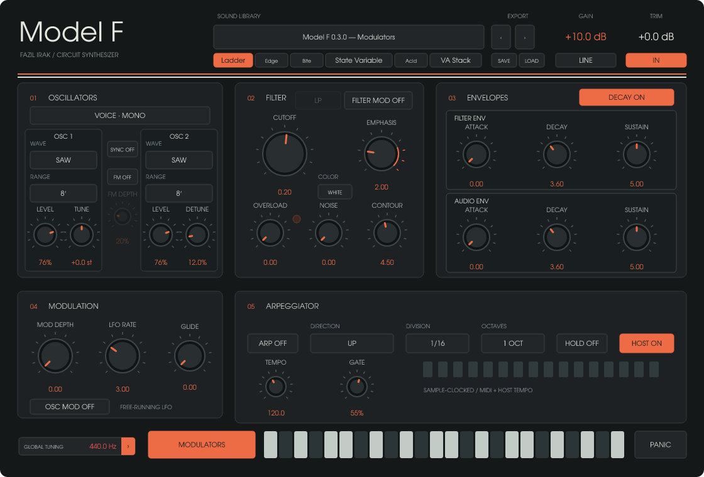
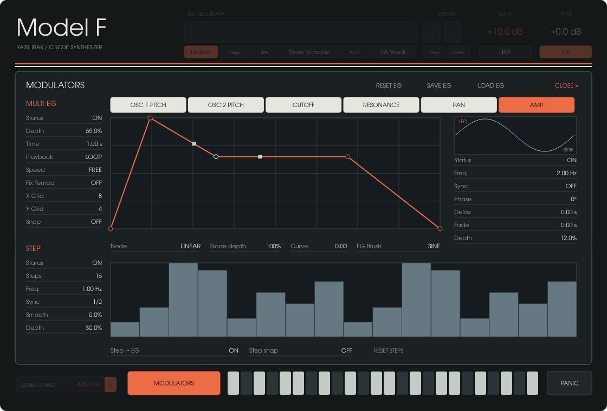

# Model F 0.3.0 — Independent modulation and new preamp

Developed and maintained by **Fazıl Irak**. Free/open-source Rust/NIH-plug synthesizer.

- **Six independent destinations:** OSC 1 Pitch, OSC 2 Pitch, Cutoff, Resonance, Pan and Amp, each with Multi EG, LFO and Step Sequencer.
- **Multi EG:** simple initial drawing, editable breakpoints/curves, eight-wave EG Brush, grid/snap, tempo options and shape save/load.
- **LFO and Step:** independent timing/depth per target; LFO phase/delay/fade; 2–128 steps with smoothing, sync and EG retrigger.
- **GAIN/TRIM preamp:** drag numeric values; MIC/LINE sensitivity and IN bypass. Trim remains active when colour is bypassed.
- Compact label–value editor, consistent header, EG Brush beneath the EG graph and grey/orange/ivory source activity indicators.
- Fixes the first edit after preset loading enabling an unrelated EG. Hidden legacy AD is no longer converted into an enabled destination. Existing visible Multi EG transfer and independent pitch editing are retained.
- Modulation coefficient caching and fewer redundant parameter sends. CPU benefit is modest and workload-dependent; see measured scope below.

## Downloads and validation

Windows x64: VST3, CLAP, standalone. macOS Universal arm64 + x86_64: VST3, CLAP, standalone, macOS 11+; no AU. Mac bundles are ad-hoc signed, not Apple notarised. Linux x64 packages are attached by their separate native build after successful checks.

Native Windows/macOS automated checks gate this release. Local validation recorded 90 product unit tests and 18 integration/audio tests; seven core tests also passed in the preceding engine validation. Separate real DAW, device listening and Intel/Apple Silicon hardware validation remain necessary. No claim of a comparative sound-quality or CPU advantage over other synthesizers is made.

## Compatibility

Existing plugin identities and host parameter IDs/order are retained. Older sounds keep their legacy path until edited in the new panel. Entering the new modulation system transfers only a visibly enabled legacy Multi EG; hidden AD is disabled rather than silently enabling another target. Legacy shared pitch EGs transfer to both oscillator banks before independent editing. The first preamp edit activates the new preamp path. Save copies of older sounds before editing.

## Türkçe

Model F 0.3.0; altı hedefte bağımsız Multi EG, LFO ve Step Sequencer, ayrı OSC perde sayfaları ve GAIN/TRIM preamp getirir. EG başlangıcı sadeleştirildi; noktalar, eğriler ve EG Brush ile multistage çizimler oluşturulabilir. İlk tıklamada başka kapalı hedefin açılması ve yanıltıcı etkinlik renkleri düzeltildi.

MIC daha erken doygunlaşır, LINE daha temiz kalır. IN kapalıyken Trim çalışır. Preamp çıkış limiter’i değildir. Eski presetler yeni panelde düzenlendiğinde gizli AD yolu sona erer; özel kayıtların kopyasını saklayın.

## Source and licences

Matching complete source archives accompany the binaries, including locked/vendored dependencies and original font source. GPL-3.0-or-later project terms and individual upstream/component/font notices are preserved. Original application contributions by Fazıl Irak; circuit DSP copyright Idle Foundry Ltd. Keep corresponding source available when redistributing covered binaries.

[Usage / routing / compatibility](https://github.com/fazilirak/Music/blob/Model-F-v0.3.0/Model-F/docs/MODULATORS-030-TR.md) · [CPU measurement scope](https://github.com/fazilirak/Music/blob/Model-F-v0.3.0/Model-F/docs/CPU-030-TR.md)
