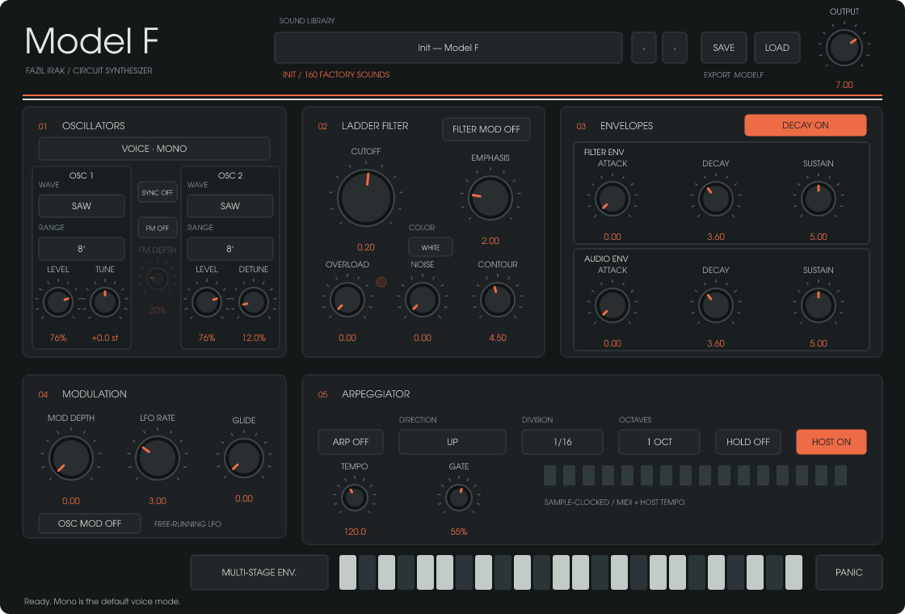
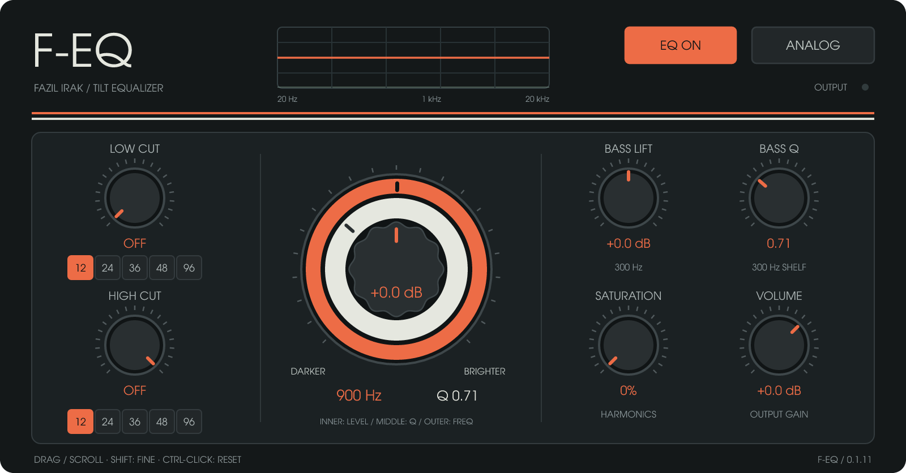
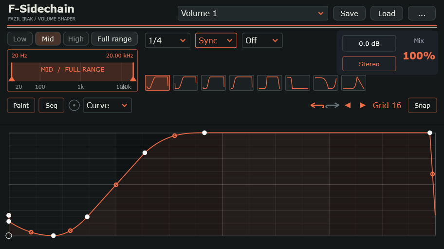
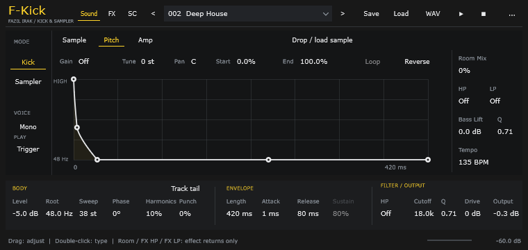

# Music — FAZIL AHMET IRAK

Independent music software and development resources by [FAZIL AHMET IRAK](https://fazilirak.com).

[Explore all seven products — Türkçe](https://fazilirak.com/muzik-yazilimlari/) · [English](https://fazilirak.com/music-software/). Each product carries Fazıl Irak’s developer identity; original upstream/component copyrights and licences remain applicable.

| Project | Developer / maintainer | Windows | macOS | Linux x64 | Source |
| --- | --- | --- | --- | --- | --- |
| [F-Saturator](F-Saturator/README.md) | Fazıl Irak | [0.5.3](https://github.com/fazilirak/Music/releases/tag/F-Saturator-v0.5.3) | [Universal 0.5.3](https://github.com/fazilirak/Music/releases/tag/F-Saturator-v0.5.3) | [0.5.3](https://github.com/fazilirak/Music/releases/download/F-Saturator-v0.5.3/F-Saturator-0.5.3-Linux-x64.tar.gz) | [Browse](F-Saturator) |
| [F-Kick](F-Kick/README.md) | Fazıl Irak | [0.8.3](https://github.com/fazilirak/Music/releases/tag/F-Kick-v0.8.3) | [Universal 0.8.3](https://github.com/fazilirak/Music/releases/download/F-Kick-v0.8.3/F-Kick-0.8.3-macOS-Universal.tar.gz) | [0.8.3](https://github.com/fazilirak/Music/releases/download/F-Kick-v0.8.3/F-Kick-0.8.3-Linux-x64.tar.gz) | [Browse / licences](F-Kick) |
| [F-TransForm](F-TransForm/README.md) | Fazıl Irak | [0.2.2](https://github.com/fazilirak/Music/releases/tag/F-TransForm-v0.2.2) | [Universal 0.2.2](https://github.com/fazilirak/Music/releases/download/F-TransForm-v0.2.2/F-TransForm-0.2.2-macOS-Universal.tar.gz) | [0.2.2](https://github.com/fazilirak/Music/releases/download/F-TransForm-v0.2.2/F-TransForm-0.2.2-Linux-x64.tar.gz) | [Browse / licences](F-TransForm) |
| [F-Sidechain](F-Sidechain/README.md) | Fazıl Irak | [1.1.2](https://github.com/fazilirak/Music/releases/tag/F-Sidechain-v1.1.2) | [Universal](https://github.com/fazilirak/Music/releases/tag/F-Sidechain-v1.1.2) | [1.1.2](https://github.com/fazilirak/Music/releases/download/F-Sidechain-v1.1.2/F-Sidechain-1.1.2-Linux-x64.tar.gz) | [Browse / licences](F-Sidechain) |
| [Jellybone](Shaper/README.md) | Fazıl Irak | [Releases](https://github.com/fazilirak/Music/releases/tag/Jellybone-v0.8.4) | [Universal](https://github.com/fazilirak/Music/releases/tag/Jellybone-v0.8.4) | [0.8.4](https://github.com/fazilirak/Music/releases/download/Jellybone-v0.8.4/Jellybone-0.8.4-Linux-x64.tar.gz) | [Browse](Shaper) |
| [Model F](Model-F/README.md) | Fazıl Irak | [0.2.8](https://github.com/fazilirak/Music/releases/tag/Model-F-v0.2.8) | [Universal](https://github.com/fazilirak/Music/releases/tag/Model-F-v0.2.8) | [0.2.8](https://github.com/fazilirak/Music/releases/download/Model-F-v0.2.8/Model-F-0.2.8-Linux-x64.tar.gz) | [Browse / licences](Model-F) |
| [F-EQ](F-EQ/README.md) | Fazıl Irak | [0.1.11](https://github.com/fazilirak/Music/releases/tag/F-EQ-v0.1.11) | [Universal](https://github.com/fazilirak/Music/releases/tag/F-EQ-v0.1.11) | [0.1.11](https://github.com/fazilirak/Music/releases/download/F-EQ-v0.1.11/F-EQ-0.1.11-Linux-x64.tar.gz) | [Browse / licences](F-EQ) |

F-Kick and F-TransForm also provide macOS Universal VST3, AU and standalone packages. [Build, installation and test scope](docs/ORIGINALS_MACOS_TR.md).

## F-Saturator

**Add colour. Shape the character.** Free saturation/distortion for Windows x64 and macOS Universal. VST3 and standalone, plus AU on macOS.

Five original character models — Console, Transformer, Tape, Triode and Pentode — with 16 presets, 8× FIR oversampling and two ADAA stages. Shape drive, tone, bias, dynamics and stereo width in a focused interface. Character (Warm–Sizzle), Harmonic Balance (Even–Odd) and subtle Analog Drift shape the saturation. Compact Transient, Comp, Bass and Treble controls include ATT/REL and Tight LED switches. Version 0.5.3 keeps the fixed 1040 × 640 editor and separates the preset/footer row from the knob panel.

- [Source and build instructions](F-Saturator/README.md)
- [Türkçe geliştirme rehberi](F-Saturator/GELISTIRME-TR.md)
- [Source review notes / İnceleme notları](F-Saturator/REVIEW-TR.md)
- [Downloads / Releases](https://github.com/fazilirak/Music/releases)
- [Product overview / Ürün tanıtımı](https://fazilirak.com/f-saturator-english/)

## Türkçe

Müzik yazılımlarımı bu depoda ayrı proje klasörleriyle yayımlıyorum. F-Saturator kaynaklarında Türkçe açıklamalar ve düzenleme rehberi bulunur. Windows, macOS ve Linux indirmeleri sürümlerin **Releases** bölümündedir.

## Licensing

Each project has its own licence. F-Saturator is AGPLv3-or-later; see [its licence](F-Saturator/LICENSE), [JUCE notice](F-Saturator/JUCE-LICENSE.md) and embedded font notices. This repository does not assign a common licence to projects that may be added later.

Website: https://fazilirak.com · Contact: info@fazilirak.com

## Jellybone

Formerly Shaper. Effects rack by Fazıl Irak: Gate, Time, Filter, Reverb, Pan, Volume, Saturation and Pitch. The new Jellybone name preserves existing plugin and preset identities.

- [Source, licences and Windows build instructions](Shaper/README.md)
- [macOS Universal build instructions](Shaper/README.md#install-and-build)
- [macOS build workflow](https://github.com/fazilirak/Music/actions/workflows/shaper-release.yml)
- [Source and binary distribution requirements](Shaper/docs/YAYIN_LISANSLARI_TR.md)

Jellybone preserves the individual GPLv3, AGPLv3, MIT and other dependency licences;
see [COPYING](Shaper/COPYING.txt) and [third-party notices](Shaper/THIRD-PARTY-NOTICES.txt).

## Model F

**Few controls. Big sound. Built especially for techno.** Circuit-modelled synthesizer: mono/poly/SuperSaw, multi-stage envelope, arpeggiator and 160 factory presets. Existing Rust/NIH-plug edition; not the cancelled JUCE rewrite.

## F-EQ

**Simple control. Focused tone shaping.** Product design and development: **Fazıl Irak**. F-EQ 0.1.11 standardises the visible and bundle names while preserving plugin identities. Tilt equalizer, independent bass shelf, steep cut filters, analog character, saturation and output spectrum. Existing Rust/NIH-plug edition.

Both products provide Windows x64 VST3/CLAP/standalone and macOS Universal VST3/CLAP/standalone. Mac bundles are ad-hoc signed, not Developer ID signed or Apple notarised. AU is not included. Complete corresponding source accompanies each binary release. Project code is GPL-3.0-or-later; individual third-party and embedded URW Gothic AGPLv3 licences are preserved. See each project's COPYING and third-party notices.

## F-Sidechain

**Draw the groove. Make room for your sound.** Multiband volume shaper with eight editable envelopes, Low/Mid/High bands, sync/MIDI/audio triggering and full preset/state saving. Version 1.1.2 follows the orange/ivory F-series design in a 912 × 511 panel.

[Downloads and source](F-Sidechain/README.md) · [Türkçe](https://fazilirak.com/f-sidechain/) · [English](https://fazilirak.com/f-sidechain-english/)

F-Sidechain retains GATE-12/Tilr provenance and the GPLv3/AGPLv3 component terms.

## F-Kick

**Sample the attack. Shape the body.** Original kick synthesis, sample layering and 128 original factory patches by Fazıl Irak. Version 0.8.3 adds the orange/ivory F-series design in a 912 × 432 panel, preserving the 112 clean General/Techno patches and 16 Experimental patches.

[Downloads, source and build instructions](F-Kick/README.md) · [Authors and ownership](F-Kick/AUTHORS.md)

Original F-Kick application code is © 2026 Fazıl Irak and AGPL-3.0-or-later. Third-party framework, SDK and font licences remain applicable.

## F-TransForm

**One gesture. Build the tension.** Seven original multi-effect transforms under Intensity and stepped Character controls. Logo opens offline About and licences.

[Downloads, source and build instructions](F-TransForm/README.md) · [Authors and ownership](F-TransForm/AUTHORS.md)

Original F-TransForm application code is © 2026 Fazıl Irak and AGPL-3.0-or-later. Third-party framework, SDK and font licences remain applicable.
