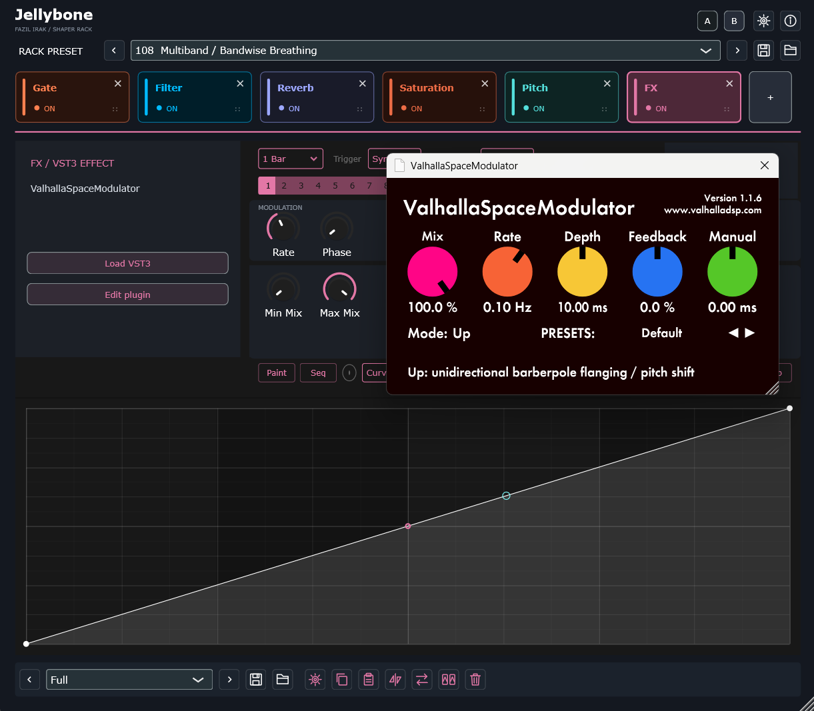
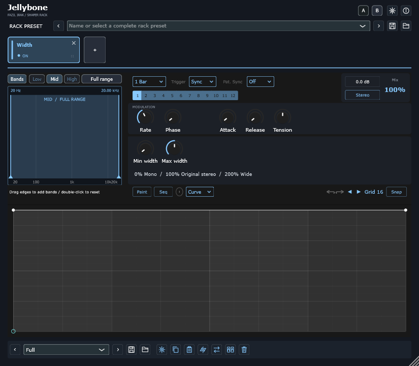
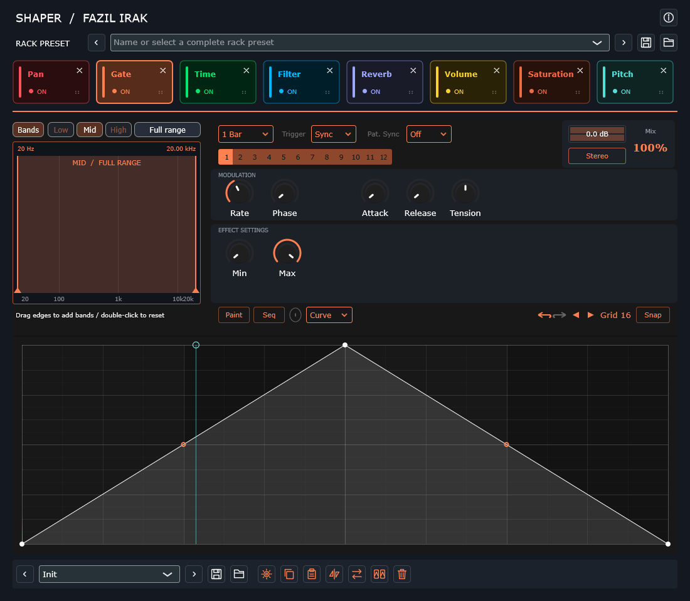

## Jellybone 0.9.1 — redesigned factory rack bank

160 rack presets rebuilt around sparse musical nodes, segment tension, S-curves and half-sine arcs.
Volume ducking, swing/trance rhythms, filter phrases, stereo gestures and Pitch/Saturation curves
are redesigned; selected racks use native Width/Delay. See [bank guide](docs/FACTORY-BANK-091.md).
Saved user racks and DAW sessions keep their stored curves; reselect a factory preset to load the new bank.

## Jellybone 0.9.0 — local Windows build

Native curve-controlled Delay (Send, Mix, Feedback, Filter) and A/B lifetime/state fixes.
QDelay 1.2.3 DelayLine and ZDF SVF components by Tilr; not the complete QDelay feature set.
See [Delay guide](docs/JELLYBONE-090-DELAY.md), [verification](docs/JELLYBONE-090-DOGRULAMA.md)
and [remaining live checks](YAPILACAKLAR.md). Six automated test groups are required before packaging.

## Latest release — 0.8.8

### Verified current downloads

| Platform | Package |
|---|---|
| Windows x64 | [Download](https://github.com/fazilirak/Music/releases/download/Jellybone-v0.8.8/Jellybone-0.8.8-Windows-x64.zip) |
| macOS Universal | [Download](https://github.com/fazilirak/Music/releases/download/Jellybone-v0.8.8/Jellybone-0.8.8-macOS-Universal.tar.gz) |
| Linux x64 | [Download](https://github.com/fazilirak/Music/releases/download/Jellybone-v0.8.8/Jellybone-0.8.8-Linux-x64.tar.gz) |

[Corresponding source and licence files](https://github.com/fazilirak/Music/releases/tag/Jellybone-v0.8.8) · Native platform builds and checks passed.

FX hosting example. ValhallaSpaceModulator by Valhalla DSP is a separate plugin, not bundled with Jellybone.

Width and FX curve controls now match their rack colours. Width and FX About pages use the Pitch layout. New instances default to 75% and remember the last closed window size. Includes A/B comparison, corner-only proportional resizing, seven zoom levels and one hosted VST3 per FX module.

[Download and corresponding source](https://github.com/fazilirak/Music/releases/tag/Jellybone-v0.8.8) · [Detailed release notes](docs/RELEASE-0.8.8.md)

<!-- Geliştirici ve bakım: Fazıl Irak | 28.10.2026 -->
# Jellybone 0.8.5

**Shape the rhythm. Build your rack.**

A modular effects rack by **Fazıl Irak**, formerly named Shaper. Add, order and automate Gate, Time, Filter, Reverb, Pan, Volume, Saturation and Pitch in one interface.

| Downloads | Links |
| --- | --- |
| Windows x64 — VST3 + standalone | [ZIP](https://github.com/fazilirak/Music/releases/download/Jellybone-v0.8.8/Jellybone-0.8.8-Windows-x64.zip) |
| macOS Universal — VST3 + AU + standalone | [TAR.GZ](https://github.com/fazilirak/Music/releases/download/Jellybone-v0.8.8/Jellybone-0.8.8-macOS-Universal.tar.gz) |
| Linux x64 — VST3 | [TAR.GZ](https://github.com/fazilirak/Music/releases/download/Jellybone-v0.8.8/Jellybone-0.8.8-Linux-x64.tar.gz) |
| Complete corresponding source | [Source ZIP](https://github.com/fazilirak/Music/releases/download/Jellybone-v0.8.8/Jellybone-0.8.8-Source.zip) |
| Notes, platform sources and checksums | [Jellybone 0.8.8](https://github.com/fazilirak/Music/releases/tag/Jellybone-v0.8.8) |

## Features

- Eight effects with editable rhythmic envelopes, MIDI/audio/tempo triggering and multiband processing.
- Drag effect cards to change signal order; independent bypass, band and effect states.
- 160 factory rack presets plus editable effect presets and complete session recall.
- Pitch/formant processing, original saturation models and independently generated reverb IR.
- Plain Jellybone logo with **FAZIL IRAK / SHAPER RACK** underneath; click it for About and component credits.

## Install and build

Replace the previous Shaper bundle when installing Jellybone: they share the same plugin identity. Existing saved settings, parameter IDs and `.shaper`/`.shapereffect` presets are preserved. The source folder and CMake target remain `Shaper`, and the existing Documents/Shaper Presets directory is retained so old presets stay accessible.

Windows: copy the entire `VST3/Jellybone.vst3` bundle to the VST3 location scanned by the DAW. Standalone: `Standalone/Jellybone.exe`. macOS: VST3 to `~/Library/Audio/Plug-Ins/VST3/`, AU to `~/Library/Audio/Plug-Ins/Components/`. Linux: complete VST3 bundle to `~/.vst3/`. Rescan in a native host. Windows binaries are unsigned; Mac bundles are ad-hoc signed, without Apple notarisation.

Build from complete source with `scripts/build-windows.cmd` or `bash scripts/build-macos.sh`; Linux uses CMake/Ninja with `SHAPER_BUILD_TESTS=ON`. All four CTest targets must pass before packaging. Complete sources include the preserved upstream dependencies. Real DAW/device and other-distribution testing remains separate.

## Licence and credits

Jellybone preserves the GATE-12/Tilr foundation and individual GPLv3, AGPLv3, MIT, font and SDK terms. Maintenance and modifications © 2026 Fazıl Irak. See [authors](AUTHORS.md), [COPYING](COPYING.txt), [third-party notices](THIRD-PARTY-NOTICES.txt) and [full licence texts](licenses). Complete corresponding source accompanies each binary release.

[Türkçe kullanım ve önceki Shaper sürüm notları](docs/SHAPER_HISTORY_TR.md)

## 0.8.5 — Filter / Reverb knob colours

Fazıl Irak: Filter and Reverb now use each rotary control’s explicitly assigned colour. Removes an uninitialised legacy audio-knob flag that could randomly turn normal controls yellow. Normal Filter controls stay cyan; Reverb controls stay lavender. Explicit audio-trigger controls retain their yellow colour. DSP, parameter/plugin IDs and preset/session formats are unchanged.

## 0.8.7 — 3 November 2026

Proportional corner resize, seven zoom levels in a separate Settings panel, persistent A/B comparison, corrected Volume preset floors, curve-driven Width and a single-VST3 FX host. See docs/YAPILACAKLAR-087-TAMAMLANAN.md for operation, validation and limitations.
