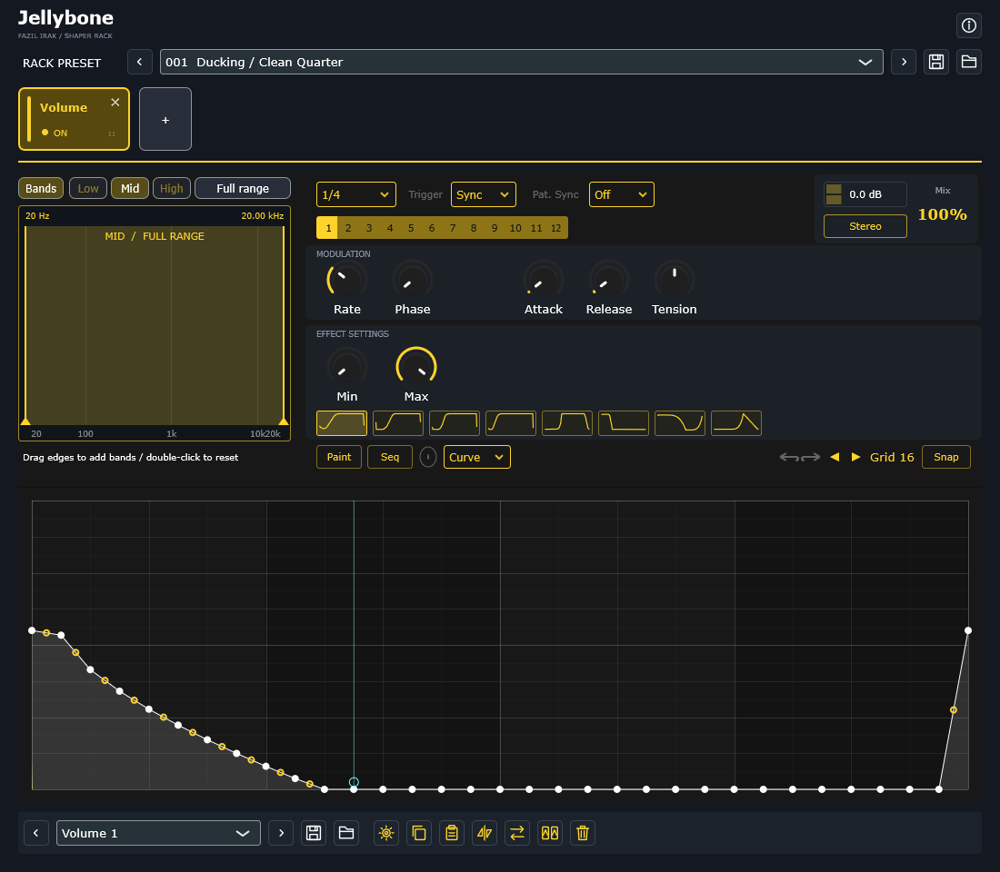

<!-- Geliştirici ve bakım: Fazıl Irak | 28.10.2026 -->
# Jellybone 0.8.4

**Shape the rhythm. Build your rack.**

A modular effects rack by **Fazıl Irak**, formerly named Shaper. Add, order and automate Gate, Time, Filter, Reverb, Pan, Volume, Saturation and Pitch in one interface.

| Downloads | Links |
| --- | --- |
| Windows x64 — VST3 + standalone | [ZIP](https://github.com/fazilirak/Music/releases/download/Jellybone-v0.8.4/Jellybone-0.8.4-Windows-x64.zip) |
| macOS Universal — VST3 + AU + standalone | [TAR.GZ](https://github.com/fazilirak/Music/releases/download/Jellybone-v0.8.4/Jellybone-0.8.4-macOS-Universal.tar.gz) |
| Linux x64 — VST3 | [TAR.GZ](https://github.com/fazilirak/Music/releases/download/Jellybone-v0.8.4/Jellybone-0.8.4-Linux-x64.tar.gz) |
| Complete corresponding source | [Source ZIP](https://github.com/fazilirak/Music/releases/download/Jellybone-v0.8.4/Jellybone-0.8.4-Source.zip) |
| Notes, platform sources and checksums | [Jellybone 0.8.4](https://github.com/fazilirak/Music/releases/tag/Jellybone-v0.8.4) |

## Features

- Eight effects with editable rhythmic envelopes, MIDI/audio/tempo triggering and multiband processing.
- Drag effect cards to change signal order; independent bypass, band and effect states.
- 160 factory rack presets plus editable effect presets and complete session recall.
- Pitch/formant processing, original saturation models and independently generated reverb IR.
- Plain Jellybone logo with **FAZIL IRAK / SHAPER RACK** underneath; click it for About and component credits.

## Install and build

Replace the previous Shaper bundle when installing Jellybone: they share the same plugin identity. Existing saved settings, parameter IDs and `.shaper`/`.shapereffect` presets are preserved. The source folder and CMake target remain `Shaper`, and the existing Documents/Shaper Presets directory is retained so old presets stay accessible.

Windows: copy the entire `VST3/Jellybone.vst3` bundle to the VST3 location scanned by the DAW. Standalone: `Standalone/Jellybone.exe`. macOS: VST3 to `~/Library/Audio/Plug-Ins/VST3/`, AU to `~/Library/Audio/Plug-Ins/Components/`. Linux: complete VST3 bundle to `~/.vst3/`. Rescan in a native host. Windows binaries are unsigned; Mac bundles are ad-hoc signed, without Apple notarisation.

Build from complete source with `scripts/build-windows.cmd` or `bash scripts/build-macos.sh`; Linux uses CMake/Ninja with `SHAPER_BUILD_TESTS=ON`. All four CTest targets must pass before packaging. Complete sources include the preserved upstream dependencies. Real DAW/device and other-distribution testing remains separate.

## Licence and credits

Jellybone preserves the GATE-12/Tilr foundation and individual GPLv3, AGPLv3, MIT, font and SDK terms. Maintenance and modifications © 2026 Fazıl Irak. See [authors](AUTHORS.md), [COPYING](COPYING.txt), [third-party notices](THIRD-PARTY-NOTICES.txt) and [full licence texts](licenses). Complete corresponding source accompanies each binary release.

[Türkçe kullanım ve önceki Shaper sürüm notları](docs/SHAPER_HISTORY_TR.md)
