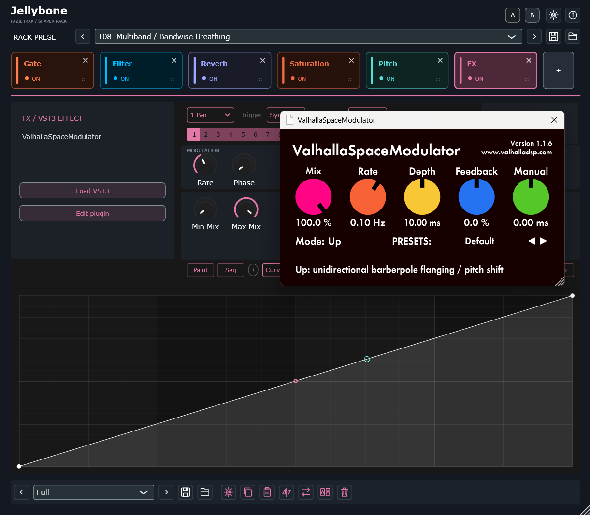

# Jellybone 0.8.8 — 3 November 2026

Width and FX curve controls now match their rack colours. Width and FX About pages use the Pitch layout. New instances default to 75% and remember the last closed window size. Includes A/B comparison, corner-only proportional resizing, seven zoom levels and one hosted VST3 per FX module.

## Türkçe

Width/FX iç kontrolleri rack renkleriyle eşleşir; Hakkında sayfaları Pitch düzenindedir. İlk açılış %75; son boyut hatırlanır. A/B, orantılı köşe boyutlandırması ve tek VST3 barındıran FX modülü dahildir.

## Downloads and matching source

- [Release, platform packages and matching source](https://github.com/fazilirak/Music/releases/tag/Jellybone-v0.8.8)
- [Windows x64](https://github.com/fazilirak/Music/releases/download/Jellybone-v0.8.8/Jellybone-0.8.8-Windows-x64.zip)

Windows Release builds and regression tests passed locally. Updated macOS/Linux packages are published only after their native CI builds and checks succeed. Previous platform releases remain available under their own version; they do not contain these interface updates.

Complete corresponding source and third-party notices accompany each release. Existing third-party copyright and licence notices are retained.

User-provided example: the FX module hosts the separately installed ValhallaSpaceModulator by Valhalla DSP. The external plugin is not bundled with Jellybone and retains its own licence; the screenshot does not imply endorsement.
